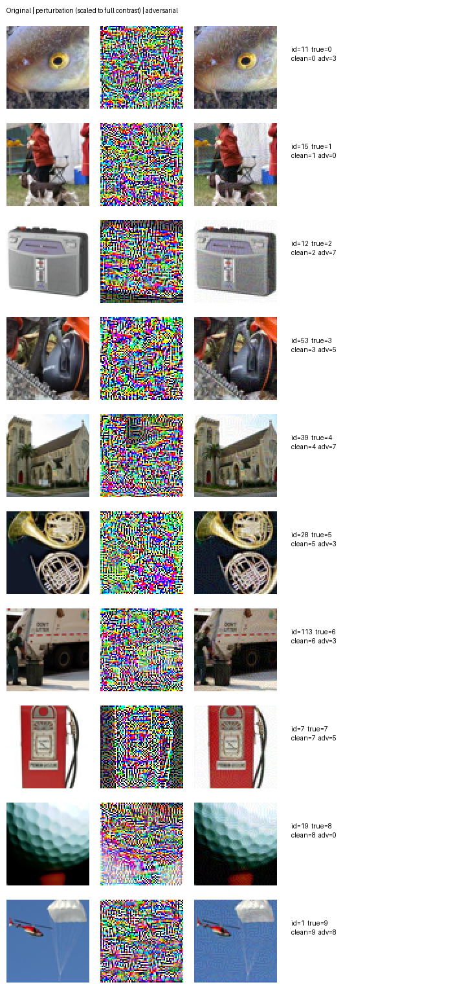

# Task 3：基线与逃逸攻击实验

实测日期：2026-11-04。设备：RTX 3060 Laptop（6 GB）。所有本地指标均为 **diagnostic**：课程模型已经见过来源训练数据，不能当作未见数据表现，也不是 Kaggle 分数。

## 基线

- 固定验证集 1,894 张：正确 1,893 张，Accuracy=0.999472，Macro-F1=0.999476。
- 全部测试集 3,925 条预测已生成，并核验模板顺序、标签范围和文件格式。
- 正式基线文件：[`results/baseline/submission_baseline.csv`](../results/baseline/submission_baseline.csv)。用户已手动提交，真实 **Kaggle Public Score = 0.51194**，提交成功的[截图证据](results/kaggle_baseline_public_score.png)于2026-11-04提供。该分数是后续防御前后比较的基线，与本地诊断分数分开记录。
- 本次验证/测试推理分别约 0.300s / 0.690s；图片初次加载分别约 1.564s / 5.316s。推理计时排除两次预热与初次图片解码，包含 batch 迭代及 CPU/GPU 数据传输；不是完整脚本墙钟耗时。

## 全量验证集上的攻击结果

| 攻击 | ε（/255） | Float Macro-F1 | 8-bit Macro-F1 | 50%混合 Macro-F1 | ASR | 耗时(s) | 峰值分配显存(MiB) |
|---|---:|---:|---:|---:|---:|---:|---:|
| fgsm_eps2 | 2 | 0.405808 | 0.405808 | 0.704806 | 0.592182 | 0.919 | 379.38 |
| fgsm_eps4 | 4 | 0.263681 | 0.263681 | 0.639232 | 0.739039 | 0.885 | 379.38 |
| fgsm_eps8 | 8 | 0.191187 | 0.191187 | 0.607956 | 0.805071 | 0.940 | 379.38 |
| pgd10_eps4 | 4 | 0.000610 | 0.000610 | 0.504367 | 0.999472 | 5.863 | 394.39 |
| pgd10_eps8 | 8 | 0.000000 | 0.000000 | 0.508979 | 1.000000 | 5.782 | 394.39 |
| pgd20_eps8_r3 | 8 | 0.000000 | 0.000000 | 0.512591 | 1.000000 | 28.904 | 678.20 |

- ASR 分母为干净条件下分类正确的 1,893 张，分子为其中被攻击后误分类的数量；不把原本已错的样本计为成功攻击。
- PGD step_size=2/255。pgd10 使用随机起点、10步、1次起点；pgd20_eps8_r3 使用20步、3次独立随机起点。全部为针对课程模型的白盒、非定向攻击。
- PGD 每张图片保留所有迭代与起点中的成功误分类候选；同为成功或同为失败时取交叉熵更高者。干净输入纳入候选，保证已错误的图片不会被后续偶然纠正而掩盖失败。PGD未注入FGSM候选。
- 混合条件固定 seed=5578，抽取947张使用 float 对抗预测，其余947张使用干净预测，所有攻击共用同一掩码。直接在合并预测上计算Macro-F1；没有平均两个F1。该构造不保证与真实测试攻击分布相同。
- 8-bit 结果使用 round(255*x_adv)/255 重新推理。float 与 8-bit 扰动最大值均通过预算检查，允许1e-6浮点误差。JSON保留实际测量值。
- 攻击计时排除预热与初次图片加载，包含攻击生成、float/8-bit推理、数据传输和统计；不包含结果文件写入。显存为PyTorch最大已分配量，不是系统总显存占用。

## 结论与边界

原模型在干净的已见数据上几乎全部正确，但PGD在8/255预算下可使全部1,893张原本正确的图片误分类；8-bit取整后仍全部错误。当前模型对已测试攻击明显脆弱，第四步应同时优化干净与对抗表现。

这些结果不能推出所有攻击都同样有效，也不能推断测试集标签或Kaggle分数；不存在认证鲁棒性结论。混合条件下F1约0.51只是本地构造结果。第四步尚未进行，下一设备参见 [step4_plan.md](step4_plan.md)。

## 验证与复现

```powershell
.venv/Scripts/python.exe -m unittest discover -s tests -v
.venv/Scripts/python.exe -m dataset3.baseline
.venv/Scripts/python.exe -m dataset3.evaluate_attacks
```

两次基线运行的预测CSV与全部logits逐位一致；两次六组攻击的float和8-bit预测CSV逐字节一致。原始图片和课程权重未修改。详细指标、每类指标和混淆矩阵位于 [results/](results/)。本页攻击耗时采用第二次带8-bit扰动统计的运行，原始本地目录为 runs/attacks_verified/；标准命令默认写入 runs/attacks/。

## 课件算法对应

FGSM：$x_{adv}=\operatorname{clip}_{[0,1]}(x+\epsilon\operatorname{sign}(\nabla_x CE(f(x),y)))$。

PGD：$x^{t+1}=\Pi_{[0,1]\cap[x-\epsilon,x+\epsilon]}(x^t+\alpha\operatorname{sign}(\nabla_{x^t} CE(f(x^t),y)))$，并从预算范围内随机初始化。

对应 Week 5 的 FGSM、PGD 与鲁棒性评估内容。梯度通过模型内部规范化回传至原始像素；不修改权重，不将标签改成攻击目标类。

## 可视化

每类选择最后一组PGD中第一个“原本正确、攻击后错误”的样本，属于说明性选例，不是随机抽样。中列为放大到完整对比度的扰动，实际扰动远小于展示强度。


