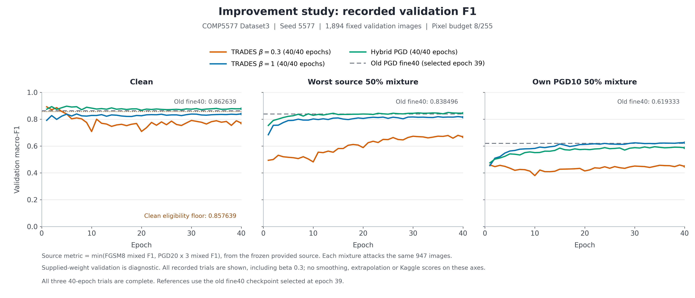

# Bounded Public Score improvement study — 2026-11-05–06

Candidate 2 has a **user-reported Kaggle Public Score of 0.85725**, received on 2026-11-06. The requested Public Score target of at least 0.85 is therefore achieved on the user's reported result. This is +0.05307 over the prior best 0.80418, +0.03909 over candidate 1's 0.81816, and +0.34531 over the original 0.51194 baseline; it exceeds the target by 0.00725. Both new scores are supported by user text replies, not screenshots or server-side artifact checksums. Submission IDs, exact submission times, and final Select states remain unknown. [Recorded score evidence](results/public85/kaggle_scores.json).

The training study was scoped to approximately 1–2 hours of additional local work, with the original 15:47 Asia/Shanghai budget boundary. This update records the completed 80-epoch residual experiment and the later user-reported Public result. It preserves failed trials and separates local diagnostics, full-data final fitting, and actual Public Scores. All six post-freeze security-check jobs completed in290.313s. Their measured results are reported below; Public success does not imply general white-box robustness.

## Protocol and limitations

Only the supplied Dataset 3 records, supplied classifier, and newly initialized models are used. Seed 5577 and the committed 7,575/1,894 train/validation split remain unchanged. Input pixels are in [0,1], model normalization is internal, and generated attack perturbations satisfy Linf<=8/255. No external data or pretrained weights are introduced.

Selection first prefers clean macro-F1>=0.857639, the earlier fine-tuned model's clean F1 minus .005. Among equally eligible candidates, it maximizes the worse of the frozen provided-source FGSM8 and PGD20x3 mixed macro-F1 scores, then clean F1. An exact tie keeps the earlier epoch. Mixed metrics use the same 947 attacked positions, chosen with seed 5578, and are recomputed from individual predictions rather than averaging two F1 scores. Ineligible checkpoints are retained for diagnosis and are not automatically promoted.

The provided classifier originally saw the entire supplied labeled dataset, including validation IDs. Its fine-tuned descendants' validation results are therefore diagnostic. The random residual student excludes validation images from its own gradient updates, but its provided attack teacher already saw those IDs; this also prevents an independent unseen-data claim. Repeated selection on this validation set adds further selection bias. The deployed ensemble additionally contains a hybrid member refitted on all 9,469 labeled records, directly including validation images. Any later validation checks of that deployed ensemble are in-sample security diagnostics. Source-transfer performance does not establish adaptive white-box robustness, and none of these local measurements establishes a Kaggle score or a robustness certificate. The reported Public Scores come from the user's submission feedback separately.

## Completed objective trials

All three trials start from the supplied weights and use 40 epochs, batch 128, SGD learning rate .01, momentum .9, weight decay .0005, cosine decay, and training-only crop/flip augmentation. TRADES uses clean CE + beta KL(p_clean||p_adversarial), with a detached eval-mode inner reference and gradients through both outer distributions. Its random-start inner KL ascent uses 7 steps of 2/255. The two beta values, .3 and 1, were declared before training. Hybrid uses .75 clean CE +.25 adversarial CE; each shuffled batch assigns floor-half of its augmented images to current-model PGD7 and the remainder to frozen-provided-source PGD7.

Every epoch evaluates the complete validation set under clean inference, own-model PGD10, and cached original-source FGSM8/PGD20x3. The following rows describe the recorded selected checkpoint, not the final epoch unless those coincide. All values are macro-F1.

| Trial | Selected epoch | Clean | Source FGSM mixed | Source PGD20x3 mixed | Worst source mixed | Own PGD10 mixed | Clean eligible |
|---|---:|---:|---:|---:|---:|---:|:---:|
| Earlier fine 40 reference |39/40|.862639|.838496|.848462|.838496|.619333|Yes|
| TRADES beta 0.3 |3/40|.886343|.656959|.531179|.531179|.456078|Yes|
| TRADES beta 1 |39/40|.835496|.819390|.826417|.819390|.623992|No|
| Hybrid |37/40|.874692|.850292|.859801|.850292|.588201|Yes|

TRADES beta 0.3 is a negative result despite its early clean eligibility. Its last epoch has clean F1 .770978 and worst-source mixed F1 .668606, so later transfer improvements do not satisfy the clean requirement. Beta 1 improves own-model attacked performance but never produces an eligible selected checkpoint. Hybrid improves the reference's worst-source mixed F1 by .011796 while reducing own-PGD10 mixed F1 by .031132. This is a transfer-oriented tradeoff, not an overall robustness improvement.

Recorded epoch-time sums are 513.623 s for beta 0.3, 523.022 s for beta 1, and 511.945 s for hybrid. These sums cover the logged epoch computations and validation, not complete process wall time or all setup/checkpoint-writing costs. Raw evidence is in `runs/improve_trades_beta03/metrics.json`, `runs/improve_trades_beta1/metrics.json`, and `runs/improve_hybrid/metrics.json`; the earlier reference is in `docs/results/defense_pgd_augmented.json`.



## Negative preprocessing and ensemble probes

The initial 56-setting screen used the whole validation set with the cached original-source PGD20x3 attacks. Probability averaging across identity+horizontal-flip views improved fine 40's PGD-source mixed F1 from .848462 to .852417. Six views, adding four reflection-padded 2 pixel shifts, reached .850540. The best tested fine 40/random 50 probability ensemble, 75%/25% with identity+flip, reached .849089 and did not beat the single fine 40 flip predictor. Mild Gaussian blur with original-image mixing alpha .25/.5 reduced fine 40's mixed F1 to .837542/.809743. These are PGD-source-only mixed values, not the later worst-of-FGSM/PGD criterion. Full scores are archived in `docs/results/public85/old_model_probe.json`; raw logits remain in the ignored local `work/improvement_probe/logits.npz`.

A separate internal-scale screen evaluated eight fixed combinations of 64/80/96 pixel views, with and without flip. Under the two-source criterion, old fine 40 at 64+flip reached .844977, while hybrid at 64+flip reached .851485. Adding 80 pixel views reduced hybrid's worst-source mixed F1 to .839842; adding 96 pixel views reduced it further to .822702. Resize averaging was rejected. The deployable shortlist uses native 64 pixel identity+flip probability averaging, without resize or blur. Scale results remain in `docs/results/public85/scale_tta_probe.json`.

## Batch-normalization investigation

The poor beta 0.3 trend was investigated without changing the active training code. With batch normalization frozen, independent dropout masks produced nonzero clean/clean KL on a four-image CPU probe, but the observed noise did not establish dropout as the dominant failure mechanism. On 64 seeded training IDs with dropout disabled, beta 0.3's last checkpoint had saved-statistic CE .633566 and 56 correct predictions, versus batch-statistic CE .036629 and 64 correct. Fine 40 showed the opposite direction: saved-statistic CE .127095/63 correct versus batch-statistic CE .170646/62 correct. These training-image diagnostics are not validation/test adaptation scores. The CPU evidence is archived in `docs/results/public85/dropout_diagnostic.json` and `docs/results/public85/bn_gap_diagnostic.json`.

A subsequent declared BN probe used official `torch.optim.swa_utils.update_bn`, frozen parameters, disabled dropout, and only the 7,575 training IDs. It tested clean-only calibration and equal clean/source-FGSM or clean/source-PGD10 calibration. Parameter tensors were checked bitwise unchanged, only BN buffers could change, and saved checkpoints were reloaded for identity verification.

Recalibration repaired beta 0.3 last-checkpoint clean performance but did not make it competitive: its strongest source-mixed result was .736128, with clean F1 .919178. Beta 1 remained below the clean floor. Hybrid's selected checkpoint improved from .850292 to .851411 under clean-only calibration, about .0011; the best other hybrid calibration screen reached .851441. These marginal gains did not justify promoting BN recalibration into the frozen candidate pipeline. Fine 40 recalibration also failed to improve its source criterion. All variants, including rejected ones, are recorded in `docs/results/public85/bn_recalibration_probe.json`.

## Frozen hybrid final refit and candidate 1

Before the new Public Score, the hybrid choice was frozen in `docs/results/public85/hybrid_refit_protocol.json`: restart from the supplied weights, use all 9,469 labeled records, retain the original 40 epoch cosine horizon, stop after 37 epochs, and use identity+flip inference without BN recalibration. The full-data refit performs no validation, transfer-cache evaluation, or epoch selection. It has no held-out local score.

The actual refit completed 37 epochs on 9,469 records, with validation count 0 and `selection_performed=false`. Its recorded epoch-time sum is 470.767 s. Two complete 3,925-image inference passes produced identical labels and bitwise-identical logits; the saved CSV was reloaded and checked against unique sample IDs, exact order, and integer labels 0–9. The candidate CSV is `submission_public85_hybrid_full37_flip.csv`, SHA-256 `fa3520160c6d247327adc46c7ae396dad2c07d5f4cb886b4b41377a4b6f32432`. The user reported its Public Score as 0.81816. The pre-upload inference report's `submitted_to_kaggle=false` remains a historical snapshot, not a contradiction of the later user report.

## Completed residual experiment and split-counterpart screen

The residual recipe was frozen before candidate 1's new Public Score. A random SmallResNet18(width 32, no dropout) completed all 80 epochs on the fixed 7,575 IDs. It uses batch 128, SGD learning rate .1/momentum .9/weight decay .0005, cosine decay, and equal clean/source-adversarial CE. Each adversarial image independently selects cached provided-source FGSM8 or PGD10 with probability .5. Paired crop/flip transforms preserve clean/adversarial alignment; one concatenated clean+adversarial forward gives BN equal domain counts. There is no current-student PGD inner loop during this transfer-focused training. The sum of recorded epoch times is 1,441.541 s; setup, cache loading and checkpoint writes are outside that sum.

Each epoch evaluates full clean and source FGSM8/PGD20x3 validation using the same eligibility criterion. Own-model PGD is deliberately absent from epoch selection. The recorded best checkpoint is epoch 69: raw clean F1 .847198 and worst-source mixed F1 .834209, below the clean eligibility floor. This single-model outcome remains an ineligible result even though the later ensemble succeeds.

A predeclared two-candidate screen then compared the epoch-69 residual alone against a fixed 50:50 probability ensemble of that residual and the split-trained hybrid epoch 37, with identity+flip for both. No model weight or transform sweep was performed in this screen. Both use all 1,894 validation records and the same fixed 947-position mixed mask.

| Split-counterpart screen | Clean F1 | Source FGSM mixed | Source PGD20x3 mixed | Worst source mixed | Clean eligible |
|---|---:|---:|---:|---:|:---:|
| Residual epoch 69 alone + flip |.854520|.841923|.846231|.841923|No|
| Residual69/hybrid37, fixed 50:50 + flip |.880650|.863015|.871261|.863015|Yes|

These screen scores belong to the split-trained counterparts, not to the later deployed full-refit ensemble. The residual training record is archived in [the study summary](results/public85/study_summary.json); the full screen is archived in [residual_screen.json](results/public85/residual_screen.json) and is also embedded in the candidate-2 manifest. The supplied teacher exposure and validation-based selection qualifications still apply.

## Frozen deployed candidate 2 and actual Public outcome

The deployed pipeline keeps the residual epoch 69 trained on 7,575 records and substitutes the already frozen **full-data hybrid epoch 37** for its split-trained counterpart. The hybrid full refit and its inference protocol were fixed before candidate 1's new Public feedback. The deployment uses exactly 0.5 weight per model, softmax probability averaging at temperature 1, followed by equal identity/horizontal-flip probability averaging. Equivalently, it averages four model/view probability distributions with weight 0.25 each. There is no BN recalibration, resize, blur, stochastic preprocessing, or further setting change after this pipeline was frozen.

| Deployed member | Epoch | Gradient-fitting records | Model weight | Validation exposure |
|---|---:|---:|---:|---|
| Random SmallResNet18(width 32) |69|7,575|0.5|Student excludes validation inputs; attack teacher had seen them|
| ProvidedNet hybrid full refit |37|9,469|0.5|Directly fitted all validation inputs in the frozen final refit|

Candidate 2 is `submission_public85_residual_hybrid50_flip.csv`, with exactly 3,925 unique template-ordered predictions and integer labels 0–9. Two complete inference passes produced identical predictions and bitwise-identical logits. CSV SHA-256: `180c2302fc163c247d5e7b2e7e36be46dfc80ccab446ecb385afd021f4b750c4`. The deployed pipeline SHA-256 is `9d501605c6a1702978ba64203d238287cff3ba9a06a7356a3ed3c46bacaccf7d`. The deliverable `outputs/public85/candidate2_manifest.json` records both checkpoint hashes, architecture code, exposure scopes, selection screen, transform order, and repeat-inference checks.

On 2026-11-06 the user explicitly reported candidate 2's actual Public Score as **0.85725**. This exceeds the 0.85 target. It is user-text evidence, with no screenshot, numeric submission ID, exact submission time, or known final Select state. The observed Public result does not establish a private/final leaderboard score or broad adversarial robustness. Neither the ineligible residual-alone screen nor the negative TRADES trials is erased by this ensemble result.

## Final security audit protocol

The frozen deployed predictors completed separate checks: full 1,894-record original-source/white-box FGSM/PGD10/PGD20x3 evaluation; adaptive CE and logit-margin PGD50x5 on a fixed, label-stratified 200-record subset; and reserved random50-source transfers on all 1,894 records. Adaptive attacks differentiate through the complete model-probability and flip-averaging predictor. The 200-record stress subset uses 20 images per class selected with seed 5577, independently of prediction errors; its declaration is archived in `docs/results/public85/final_check_sampling.json`.

**The completed measurements below remain separate from the Public Score. No robustness certificate is inferred.** The 200-record stress results must be labeled with their sample size and compared only against attacks on the same 200 records; they must not be presented as full-1,894 stress results. The supplied and full-refit exposure limitations also apply to these local security diagnostics.

## Reproduction and verification

Run from the repository root in the CUDA environment. Historical entry points/configurations are unchanged.

```powershell
python -m dataset3.improve_training --training configs/improve_trades_beta03.json --output runs/improve_trades_beta03 --transfer-cache runs/improve_validation_cache
python -m dataset3.improve_training --training configs/improve_trades_beta1.json --output runs/improve_trades_beta1 --transfer-cache runs/improve_validation_cache
python -m dataset3.improve_training --training configs/improve_hybrid.json --output runs/improve_hybrid --transfer-cache runs/improve_validation_cache
python -m dataset3.improve_training --training configs/improve_hybrid.json --output runs/public85_hybrid_fullrefit --final-refit --stop-after-epoch 37
python -m dataset3.predict_defense --checkpoint checkpoints/public85_hybrid_full37.pt --horizontal-flip --output runs/public85_inference_hybrid_full37
python -m dataset3.cached_source_training --training configs/public85_residual_source.json --output runs/public85_residual_source --train-cache runs/public85_bnprobe --transfer-cache runs/improve_validation_cache
python -m dataset3.predict_defense --checkpoint checkpoints/public85_residual_source.pt --ensemble-checkpoint checkpoints/public85_hybrid_full37.pt --ensemble-weight .5 --horizontal-flip --output runs/public85_inference_candidate2
python -m dataset3.evaluate_defense --checkpoint checkpoints/public85_residual_source.pt --ensemble-checkpoint checkpoints/public85_hybrid_full37.pt --ensemble-weight .5 --horizontal-flip --suite full --output runs/public85_candidate2_full
python scripts/evaluate_public85_checks.py --checkpoint checkpoints/public85_residual_source.pt --ensemble-checkpoint checkpoints/public85_hybrid_full37.pt --ensemble-weight .5 --horizontal-flip --mode stress --output runs/public85_candidate2_stress200
python scripts/evaluate_public85_checks.py --checkpoint checkpoints/public85_residual_source.pt --ensemble-checkpoint checkpoints/public85_hybrid_full37.pt --ensemble-weight .5 --horizontal-flip --mode reserved --output runs/public85_candidate2_reserved1894
python -m unittest discover -s tests -v
```

The fresh 2026-11-06 full-suite run passed all 53 tests in 1.941 s. The final-check helper also passed `py_compile`, and `git diff --check` exited 0. Coverage includes hand-computed KL direction and both gradient branches, attack constraints, source immutability/cache identity, exact epoch-boundary resume, paired augmentation, joint BN, architecture dispatch, actual mixed F1, differentiable flip/ensemble aggregation, and submission validation. These checks verify implementation behavior; final security measurements remain separate from both tests and the observed Public Score.

Exact resume uses the same output directory and unchanged configuration, original cosine horizon, protocol, source/data/code hashes, optimizer/scheduler, loader generator, and Python/NumPy/Torch/CUDA RNG states. Compact inference checkpoints cannot replace full optimizer checkpoints for resume. [Objective commands](improve_training.md) and [residual protocol](residual_source.md) provide the detailed contracts.

The user-reported Public objective is achieved at **0.85725**. The measured white-box weaknesses and unknown private/final competition result remain separate limitations.


## Completed deployed-pipeline security checks

Both delivered pipelines were frozen before these checks. Each includes the full9469 hybrid member, so the following are **in-sample security diagnostics**, not held-out estimates or further selection. All attack bounds passed in float and8-bit space. The full1894 PGD20x3 search retained every PGD10 failure. [Complete comparison](results/public85/final_comparison.json); [commands](results/public85/final_check_commands.json).

| Delivered pipeline | Clean in-sample F1 | Provided-source PGD20 mixed | Reserved random50-source PGD20 mixed | White-box PGD20 mixed | White-box PGD20 all attacked |
|---|---:|---:|---:|---:|---:|
|Hybrid full37 + flip|0.991451|0.986037|0.888931|0.687515|0.377272|
|Residual69/full37 equal ensemble + flip|0.930773|0.923071|0.807639|0.496969|0.052530|

The reserved random50 source was not used to generate this batch’s training attacks. Its transfer performance is materially weaker than the provided-source diagnostic. In particular, the Public-winning ensemble remains vulnerable to adaptive white-box PGD; Public0.85725 must not be described as general adversarial robustness.

The additional CE20x3/CE50x5/margin50x5 checks use the SAME predeclared200 IDs (20/class,seed5577), with100 attacked positions for mixed metrics. These are separate from full1894/947 results. The stronger CE search retained all shorter-search failures.

| Pipeline | Sampled200 CE20 accuracy | CE50 accuracy | Margin50 accuracy | Clean/CE50/margin joint survival |
|---|---:|---:|---:|---:|
|candidate1|0.375000|0.360000|0.350000|0.340000|
|candidate2|0.065000|0.045000|0.050000|0.035000|

Finite sampled attacks provide no robustness certificate. Complete full/reserved/stress records, actual pipeline members and SHA-256 identities are archived in results/public85/. Both candidates passed two full test-inference passes and exact3925-row submission validation. The latest53-test CPU suite passed in1.941s on2026-11-06.

## Course-source transfer at a larger budget

The frozen course-provided classifier generated PGD20×3 perturbations on the same 1,894 diagnostic images at 8/255 and 16/255. Both runs use a 2/255 step, 20 steps, three random starts, and the same seeded search protocol. The two deployment predictors classify the transferred examples. The mixed Macro-F1 uses the same fixed 947 attacked and 947 clean images at each budget.

| Deployment predictor | Original mixed F1 at 8/255 | Same-GPU mixed F1 at 8/255 | Mixed F1 at 16/255 | All-attacked F1 at 16/255 |
|---|---:|---:|---:|---:|
| Hybrid full37 + flip | 0.986037 | 0.985545 | 0.981156 | 0.972030 |
| Residual69/full37 ensemble + flip | 0.923071 | 0.922656 | 0.920431 | 0.902581 |

The original 8/255 scores were measured on an RTX 5070 Ti. The paired budget comparison was run on an RTX 3060 Laptop GPU. At 16/255, the mixed scores decrease by 0.004389 for Hybrid and 0.002226 for the ensemble relative to their same-device controls. The 16/255 condition exceeds the project's 8/255 threat budget and measures transfer from the course model on the diagnostic split. [Recorded metrics, checkpoint identities, and prediction checks](results/public85/budget_comparison.json).

Run from the repository root with the CUDA environment. Change `--epsilon-pixels 16` to `--epsilon-pixels 8` and use a separate output directory for the control.

```powershell
python -m dataset3.evaluate_defense --suite full --attack-name transfer_pgd20x3 --epsilon-pixels 16 --checkpoint models/deployed/public85_hybrid_full37.pt --horizontal-flip --output runs/public85_budget_comparison/hybrid_transfer_eps16
python -m dataset3.evaluate_defense --suite full --attack-name transfer_pgd20x3 --epsilon-pixels 16 --checkpoint models/deployed/public85_residual_source.pt --ensemble-checkpoint models/deployed/public85_hybrid_full37.pt --ensemble-weight 0.5 --horizontal-flip --output runs/public85_budget_comparison/ensemble_transfer_eps16
```
