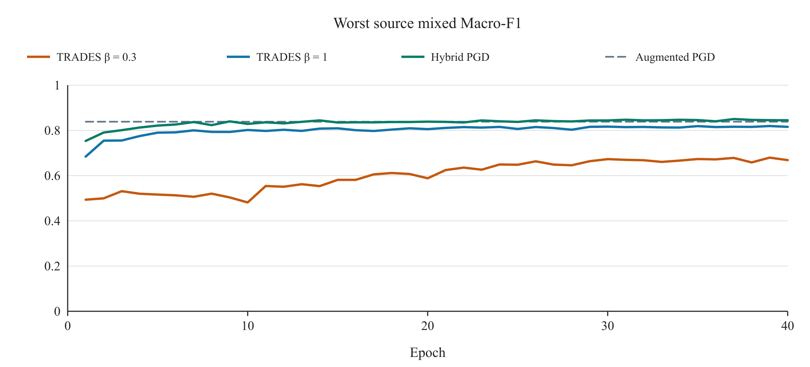

# Task 3 Adversarial Defense for Dataset 3

This report investigates defenses against image evasion attacks at inference time. The objective is to recover the true classes of a test set containing both clean and adversarially perturbed images. We first examine the vulnerability of the course-provided classifier, then compare adversarial training, training against attacks generated by the provided model, test-time augmentation, and model ensembling. The final predictor averages the class probabilities of a randomly initialized residual network and a Hybrid adversarially trained model over the original and horizontally flipped inputs. Its Kaggle Public Macro-F1 increased from 0.51194 for the undefended baseline to 0.85725. Adaptive white-box evaluation nevertheless identifies substantial remaining vulnerabilities.

## 1 Task Definition and Data

Dataset 3 contains 9,469 labeled training images and 3,925 unlabeled test images, each a 64 × 64 RGB image belonging to one of ten classes. The training images are clean. According to the project specification, the attacker generates test perturbations using the course-provided classifier; approximately half of the test images are attacked. Each color channel of each pixel may change by at most 8/255 relative to the original image. The specification describes gradient-based perturbations and gives FGSM as an example, but does not disclose the complete test attack configuration [1]. The correct label remains the class of the object depicted in the image. Evaluation uses Macro-F1, the arithmetic mean of the ten per-class F1 scores.

We retain the fixed, stratified split with seed 5577: 7,575 training images and 1,894 diagnostic validation images. The provided classifier was previously trained on the original labeled data. Consequently, local results involving that classifier, its fine-tuned descendants, or an attack teacher exposed to those data are diagnostic comparisons rather than independent estimates of generalization.

## 2 Attack Analysis and Initial Validation

The stated attack conditions motivate two representative simulations under the same perturbation budget. The Fast Gradient Sign Method (FGSM) makes a single update in the direction that increases cross-entropy with respect to the true label [2]. Projected Gradient Descent (PGD) applies repeated updates and projects the result back into the permitted perturbation region [3]. These experiments test vulnerability under plausible gradient-based attacks; they do not identify the undisclosed test attack.

FGSM uses a step of 8/255. PGD starts from a random perturbation within the budget, uses a step size of 2/255, and projects after every step onto both the L∞ ball around the clean image and the valid pixel range [0, 1]. PGD10 denotes ten steps with one random start; PGD20×3 denotes twenty steps with three random starts.

We first compare the unmodified course-provided classifier with a clean-only fine-tuned control. The control starts from the same supplied weights and is fine-tuned for ten epochs on the 7,575 clean training images. It uses a batch size of 128, stochastic gradient descent (SGD), an initial learning rate of 0.005, momentum of 0.9, weight decay of 0.0005, and cosine learning-rate decay. The best validation checkpoint is retained.

Both classifiers are evaluated on the same 1,894 images. We obtain clean predictions, freeze the provided model, and use that model to generate FGSM, PGD10, and PGD20×3 versions of the same images. Each classifier then predicts these adversarial images, and Macro-F1 is calculated against the unchanged true labels. The attack source is always the provided classifier; evaluation of the clean-only control therefore measures transfer of those attacks. Table 1 reports floating-point inputs with every validation image attacked.

Table 1. Initial diagnostics under attacks generated by the provided classifier

| Classifier | Clean F1 | Source FGSM F1 | Source PGD10 F1 | Source PGD20×3 F1 |
| --- | --- | --- | --- | --- |
| Provided classifier | 0.999476 | 0.191536 | 0.000000 | 0.000000 |
| Clean-only fine-tuning, 10 epochs | 0.996238 | 0.189759 | 0.000000 | 0.000000 |

Both models achieve nearly perfect clean Macro-F1, but their scores fall to approximately 0.19 under source FGSM and to zero under either PGD configuration. Continuing clean-only training preserves clean classification while providing little protection against these attacks. We therefore introduce adversarial examples into training so that the classifier learns from both clean and perturbed inputs.

## 3 Defense Design and Model Selection

### 3.1 Training Objectives and Attack Sources

The initial adversarial fine-tuning experiment starts from the supplied weights and trains for ten epochs with equal weights on clean and adversarial cross-entropy. Training examples are attacked against the current model using seven-step PGD with one random start; the final iterate is used. Table 2 shows a substantial improvement under transferred FGSM and PGD attacks, accompanied by a reduction in clean performance.

Table 2. Diagnostics after ten epochs of initial PGD fine-tuning

| Classifier | Clean F1 | Source FGSM F1 | Source PGD10 F1 | Source PGD20×3 F1 |
| --- | --- | --- | --- | --- |
| PGD fine-tuning, 10 epochs | 0.785492 | 0.730486 | 0.750074 | 0.748946 |

To improve the balance between clean classification and resistance to perturbations, we next conduct forty epochs of augmented PGD fine-tuning from the supplied weights. Random cropping and horizontal flipping are added, and the clean and adversarial loss weights are set to 0.75 and 0.25. The selected epoch-39 checkpoint has a clean diagnostic F1 of 0.862639 and a Kaggle Public score of 0.80418. A separate model with the same provided network architecture, randomly initialized weights, and equally weighted clean and adversarial losses is trained for fifty epochs; its Public score is 0.79277.

We then compare two TRADES settings with Hybrid training. TRADES combines clean cross-entropy with a Kullback–Leibler (KL) divergence penalty between the complete clean and adversarial class-probability distributions [4]. Its objective is

$$
L = \mathrm{CE}_{\mathrm{clean}} + \beta\,\mathrm{KL}(p_{\mathrm{clean}} \parallel p_{\mathrm{adv}})
$$

Here, p_clean and p_adv are the predicted distributions for the clean and adversarial inputs. The KL direction is from the clean distribution to the adversarial distribution. We test β = 0.3 and β = 1. The inner maximization uses seven KL-attack steps and detaches the clean reference distribution. During the outer parameter update, gradients are retained through both prediction branches.

Hybrid training uses weighted clean and adversarial cross-entropy:

$$
L = 0.75\,\mathrm{CE}_{\mathrm{clean}} + 0.25\,\mathrm{CE}_{\mathrm{adv}}
$$

In each shuffled batch, approximately half of the images receive PGD7 perturbations generated against the current model, and the other half receive PGD7 perturbations generated against the frozen provided model. Both attacks are generated after the training augmentation. Every training example contributes a clean term and an adversarial term; the 0.75:0.25 ratio weights the two losses rather than specifying the fraction of images attacked. Training runs for forty epochs with batch size 128, SGD initial learning rate 0.01, momentum 0.9, weight decay 0.0005, cosine decay, random cropping, and horizontal flipping.

### 3.2 Selection Criteria and Objective Comparison

Checkpoint selection first prioritizes candidates meeting the clean Macro-F1 threshold of 0.857639. This threshold is the earlier augmented-PGD reference score, 0.862639, minus a manually chosen tolerance of 0.005. Among eligible candidates, selection maximizes the lower of the two 50% mixed-condition F1 scores obtained with provided-source FGSM8 and PGD20×3; clean F1 breaks ties. The tolerance and optimizer settings are project hyperparameters rather than course-prescribed standards. Table 3 lists the retained checkpoints; the denominator in the epoch column is the full learning-rate schedule length. An ineligible checkpoint is shown for diagnostic comparison when a run never meets the clean threshold.

Table 3. Local diagnostic comparison of training objectives

| Candidate | Selected epoch | Clean F1 | Worst source mixed F1 | Meets clean threshold |
| --- | --- | --- | --- | --- |
| Earlier augmented PGD reference | 39 / 40 | 0.862639 | 0.838496 | Yes |
| TRADES β = 0.3 | 3 / 40 | 0.886343 | 0.531179 | Yes |
| TRADES β = 1 | 39 / 40 | 0.835496 | 0.819390 | No |
| Hybrid | 37 / 40 | 0.874692 | 0.850292 | Yes |

The early TRADES β = 0.3 checkpoint retains clean performance but provides weak transfer protection; its clean F1 falls to 0.770978 at the final epoch. TRADES β = 1 produces no checkpoint meeting the clean threshold. Hybrid improves the worst source mixed F1 over the reference by 0.011796 and is retained. However, its own-model PGD10 mixed F1 falls from the reference value of 0.619333 to 0.588201, exposing a trade-off between transfer protection and adaptive white-box performance.

Figure 1. Worst source mixed Macro-F1 over all forty epochs for the three objective trials. Each point is the lower of the provided-source FGSM8 and PGD20×3 mixed-condition scores. The dashed line denotes the earlier augmented-PGD reference.

### 3.3 Residual Network and Final Ensemble

To introduce architectural diversity, we implement SmallResNet18 with base width 32 [5]. Averaging the models' class probabilities equally may let the residual model correct Hybrid on new images. Its input stem is a 3 × 3 convolution with stride 1 and no initial max pooling. Four residual stages use 32, 64, 128, and 256 channels, with two basic residual blocks per stage. Global average pooling is followed by a ten-class linear head. The network uses no dropout or external pretrained weights.

The residual network is trained from random initialization on the 7,575 training images for eighty epochs with batch size 128 and an initial SGD learning rate of 0.1. Momentum, weight decay, and cosine scheduling follow the earlier settings. FGSM8 and PGD10 perturbations are first cached using the frozen provided classifier; each training image selects either attack with equal probability. Each clean–adversarial pair receives the same crop and flip. The two domains are concatenated for one joint forward pass, allowing batch normalization to observe both, and clean and adversarial cross-entropy receive equal weight. This procedure targets source-attack transfer; it does not generate online self-PGD examples against the residual student in every batch.

The retained residual checkpoint at epoch 69 does not meet the clean threshold on its own. Averaging original and flipped predictions yields clean F1 of 0.854520 and worst source mixed F1 of 0.841923. A fixed 50:50 probability ensemble with the split-trained Hybrid epoch-37 checkpoint raises these scores to 0.880650 and 0.863015, respectively, and passes selection.

Before deployment, Hybrid is restarted from the supplied weights and trained on all 9,469 labeled images for a fixed thirty-seven epochs while retaining the original forty-epoch cosine schedule. No validation or further epoch selection is performed. The frozen full-data Hybrid replaces the split-trained Hybrid in the final predictor; the residual checkpoint remains at epoch 69. Prediction averages four class-probability distributions with equal weights: two models, each evaluated on the original and horizontally flipped input. The class with the highest average probability is returned. Probabilities, rather than raw logits, are averaged.

We also examine blur, additional translations, multiscale averaging, and training-set batch-normalization recalibration. Adding 80- or 96-pixel views reduces the source-attack diagnostic scores. Hybrid batch-normalization recalibration improves worst source mixed F1 by only approximately 0.0011. These steps are therefore excluded from the final predictor.

## 4 Kaggle Results and Security Evaluation

### 4.1 Public Leaderboard Results

Table 4 summarizes the five actual Kaggle Public results. The final ensemble improves on the previous best score of 0.80418 by 0.05307 and on the deployed Hybrid-only predictor by 0.03909. All differences are absolute Macro-F1 increases.

Table 4. Actual Kaggle Public Macro-F1 results

| Method | Public Macro-F1 | Increase over baseline |
| --- | --- | --- |
| Undefended provided classifier | 0.51194 | 0.00000 |
| Randomly initialized PGD, 50 epochs | 0.79277 | 0.28083 |
| Augmented PGD fine-tuning, 40 epochs | 0.80418 | 0.29224 |
| Full-data Hybrid, 37 epochs, with flip averaging | 0.81816 | 0.30622 |
| Residual–Hybrid ensemble with flip averaging | 0.85725 | 0.34531 |

### 4.2 Transfer and Adaptive White Box Attacks

After freezing the defense, we evaluate attacks from several sources. Provided-source attacks continue to use the frozen course classifier. Additional transfer attacks use random50, the randomly initialized fifty-epoch PGD model, which was not used as an attack source for training the final defense. Adaptive white-box attacks instead optimize perturbations directly against the predictor being evaluated. For the final ensemble, gradients pass through both models, probability averaging, and the horizontal-flip branches.

The full evaluation tests FGSM, PGD10, and PGD20×3 on the same 1,894 diagnostic images at the course budget of 8/255. Table 5 reports floating-point Macro-F1 for PGD20×3. The mixed score combines predictions from a fixed set of 947 attacked and 947 clean images.

Table 5. PGD20×3 diagnostics at 8/255 for the two deployment predictors

| Predictor | Course-source mixed F1 (8/255) | random50-source mixed F1 | White-box mixed F1 | White-box all-attacked F1 |
| --- | --- | --- | --- | --- |
| Hybrid with flip averaging | 0.986037 | 0.888931 | 0.687515 | 0.377272 |
| Final ensemble with flip averaging | 0.923071 | 0.807639 | 0.496969 | 0.052530 |

Table 6 compares 8/255, 16/255, 32/255, and 64/255. Only the frozen course classifier supplies gradients for PGD20×3 (2/255 step size, 20 iterations, three random starts). The search retains misclassifying candidates. Both predictors share the perturbations and mixed mask. All-attacked F1 uses all 1,894 perturbed images. Budgets above 8/255 serve as in-sample stress tests.

Table 6. Course-source PGD20×3 transfer across perturbation budgets

| L∞ budget | Hybrid Mixed F1 | Hybrid All-attacked F1 | Final ensemble Mixed F1 | Final ensemble All-attacked F1 |
| --- | ---: | ---: | ---: | ---: |
| 8/255 | 0.985545 | 0.980707 | 0.922656 | 0.914274 |
| 16/255 | 0.981156 | 0.972030 | 0.920431 | 0.902581 |
| 32/255 | 0.970301 | 0.946673 | 0.896669 | 0.862166 |
| 64/255 | 0.873037 | 0.747638 | 0.789020 | 0.633979 |

From 32/255 to 64/255, mixed F1 falls by 9.73 percentage points for Hybrid and 10.76 for the final ensemble. Using a mixed F1 of 0.90 as a reference, Hybrid is above it at 32/255 and below it at 64/255. The final ensemble is above it at 16/255 and below it at 32/255.

Although the ensemble leads on the Public leaderboard, it is substantially weaker than Hybrid under these adaptive white-box attacks. The measured gain therefore concerns the course test scenario and does not establish broad white-box robustness. Transfer performance also decreases when the attack source changes to random50, demonstrating the importance of evaluating sources beyond the provided classifier.

A fixed 200-image subset is sampled with seed 5577 and twenty images per class. Fifty-step, five-start white-box PGD is run separately with cross-entropy (CE) and margin objectives. The final ensemble achieves Macro-F1 of 0.049514 under CE-PGD50×5 and 0.054438 under margin-PGD50×5. Only 3.5% of images are classified correctly under all three conditions—clean, CE attack, and margin attack—compared with 34.0% for Hybrid. Longer searches retain the failures already found by shorter searches, both for the full-set PGD10-to-PGD20×3 comparison and for CE-PGD20×3-to-CE-PGD50×5 on the same 200 images. For the original 8/255 evaluations, floating-point and eight-bit perturbations pass the budget checks.

### 4.3 Additional Evaluation with the Carlini Wagner Attack

To complement FGSM and PGD, we implement the untargeted Carlini–Wagner (C&W) L2 optimization attack [7, 8]. It minimizes squared L2 perturbation distance plus a margin penalty comparing the true class with the strongest incorrect class, balanced by a constant c. A tanh reparameterization enforces the pixel range; Adam optimizes the input variables, and c is searched separately for each image. Classifier parameters remain frozen, and gradients pass through the entire ensemble and flip-averaging procedure.

The confidence parameter is κ = 0, the initial c is 0.001, and the input-optimization learning rate is 0.01. Seven constant-search rounds are used, each with at most 500 steps and early stopping when the batch loss stagnates; batch size is 64. Standard C&W-L2 constrains pixels only to [0, 1] and may exceed the project budget. We therefore also evaluate a bounded C&W-L2 variant that restricts each channel to the intersection of [0, 1] and the original pixel ±8/255. This is C&W-L2 with an additional L∞ box constraint. The minimum-L2 successful candidate is retained across steps and constants for each image; if no successful candidate is found, the clean input is retained.

All three models use the same fixed 200-image subset, and PGD20×3 is rerun on that subset. Table 7 reports all-attacked floating-point Macro-F1. Attack success rate (ASR) is the proportion of initially correct predictions changed to incorrect predictions; images already misclassified before the attack are excluded from its denominator. Table 7 is a matched-subset comparison, whereas Table 5 uses all 1,894 diagnostic images.

Table 7. C&W and PGD on the same 200-image subset

| Predictor | PGD20×3 F1 | Standard C&W-L2 F1 | Bounded C&W-L2 F1 | Bounded C&W ASR |
| --- | --- | --- | --- | --- |
| Provided classifier | 0.000000 | 0.000000 | 0.000000 | 100.00% |
| Hybrid with flip averaging | 0.387896 | 0.000000 | 0.392553 | 62.12% |
| Final ensemble with flip averaging | 0.071876 | 0.000000 | 0.142899 | 85.79% |

Standard C&W-L2 reduces floating-point Macro-F1 to zero for all three models. However, 20, 195, and 124 outputs, respectively, exceed the project L∞ budget, so that column measures an attack with a relaxed perturbation constraint. Among successful attacks on initially correct predictions, the median minimum-found L2 distances are 0.3122, 1.6953, and 0.7230, respectively.

Under bounded C&W-L2, ASR is 100.00% for the provided classifier and 85.79% for the final ensemble; the latter has Macro-F1 of 0.142899. The defense improves over the baseline, but most initially correct images remain vulnerable. Hybrid achieves bounded-C&W F1 of 0.392553, again showing that the Public-winning method is not the strongest predictor under local adaptive attacks.

The two attack algorithms also expose different failures. Bounded C&W finds five additional failures missed by PGD20×3 for Hybrid and none for the final ensemble. The proportions classified correctly under clean input, matched-subset PGD20×3, and bounded C&W are 35.0% and 6.5%, respectively. Thus C&W supplements the failures found by PGD for Hybrid, while PGD finds more failures for the final ensemble in this experiment.

Rounding the minimum-distance floating-point candidates to eight-bit inputs raises bounded-C&W F1 to 1.000000, 0.605241, and 0.741563 for the provided classifier, Hybrid, and final ensemble, respectively. Candidates close to decision boundaries are sensitive to quantization and numerical differences between computational backends. This experiment performs post hoc quantization rather than a separate search over discrete pixels. All stored predictions have been reproduced under the same GPU settings.

## 5 Computational Performance and Resource Use

The main training and evaluation experiments use an NVIDIA GeForce RTX 5070 Ti with 16 GB VRAM, an Intel Core Ultra 9 285K, and 64 GB system memory. Software versions are Python 3.12.13, PyTorch 2.9.1+cu128, NumPy 2.2.6, and Pillow 11.3.0. Table 8 reports summed epoch timings and peak GPU memory allocated to active PyTorch tensors during training and associated validation. One MiB equals 2²⁰ bytes.

Two additional ten-epoch loss-weight comparison runs use an RTX 3060 Laptop GPU with 6 GB VRAM and Python 3.12.14, with the other software versions unchanged. Their training and per-epoch validation take 451.793 and 456.467 seconds, respectively, and both peak at 1,251.313 MiB of allocated memory. These timings exclude initial loading, checkpoint writes, and final attack evaluation.

Table 8. Main training time and peak GPU memory

| Training run | Epochs completed | Summed epoch time (s) | Peak allocated memory (MiB) |
| --- | --- | --- | --- |
| TRADES β = 0.3 | 40 | 513.623 | 1306.37 |
| TRADES β = 1 | 40 | 523.022 | 1300.20 |
| Split-trained Hybrid | 40 | 511.945 | 1306.39 |
| Residual source-attack training | 80 | 1441.541 | 2560.92 |
| Fixed full-data Hybrid refit | 37 | 470.767 | 1301.49 |

The three forty-epoch timings include training, own-model PGD10 validation, and inference under cached source attacks. Residual training includes clean and source-attack validation but no per-epoch white-box attack against the student. The full-data Hybrid refit performs no validation. All timings exclude model initialization, initial image decoding, initial attack-cache generation or loading, and checkpoint writes. The five recorded intervals sum to approximately 57.68 minutes; they do not represent the total cost of every project experiment.

Table 9 compares inference over all 3,925 test images with batch size 64. Each predictor is run twice, producing identical labels and bitwise-identical returned score tensors across its repeated runs.

Table 9. Test-set inference time and peak GPU memory

| Deployment predictor | First run (s) | Second run (s) | First-run throughput (images/s) | Peak allocated memory (MiB) |
| --- | --- | --- | --- | --- |
| Hybrid with flip averaging | 0.322 | 0.349 | 12190.77 | 174.54 |
| Final ensemble with flip averaging | 1.049 | 1.031 | 3740.66 | 252.22 |

Inference timing excludes warm-up and includes data-loader iteration, division by 255, host–device transfers, forward passes, and output transfer to the host. It excludes initial PNG decoding, model loading, metric calculation, and CSV writing. The final predictor peaks at 332 MiB of allocator-reserved GPU memory and 252.22 MiB of active allocated memory; neither quantity is the total GPU process footprint. The two compact checkpoints occupy approximately 15.25 MiB in total. Peak CPU process memory is not measured.

The ensemble requires two models and two views and therefore costs more than Hybrid alone. Nevertheless, its measured test-set inference interval is approximately one second on the stated hardware. Attack generation is more expensive: six frozen-predictor security-evaluation commands take approximately 290.31 seconds in total, including attack search and associated evaluation, outside ordinary inference.

The six C&W runs—three models under two constraint settings—take a combined 904.77 seconds for optimization and inference. The highest allocated memory among the bounded runs is 3582.28 MiB. These intervals include input transfers, perturbation search, and floating-point and eight-bit prediction, but exclude initial model and image loading, metric calculation, and file writing.

## 6 Findings and Future Work

The experiments support three findings. First, near-perfect clean diagnostic performance does not prevent failure under small gradient-based perturbations, so attacked conditions must be evaluated separately. Second, source-attack training combined with architectural diversity improves performance on the project Public evaluation subset, reaching Macro-F1 of 0.85725. Ensembling is important to the selected solution because the residual model alone does not meet the clean threshold. Third, both PGD and C&W reveal substantial adaptive white-box vulnerability. In particular, bounded C&W misclassifies 85.79% of initially correct examples for the final ensemble, demonstrating the gap between protection against transferred source attacks and adaptive white-box robustness.

Future work should prioritize more independent evaluation. Attack teachers and target models trained from random initialization only on the training partition should be tested on separately held-out data across multiple seeds, reducing bias from teacher exposure and repeated selection. Training should investigate multi-start self-PGD, additional attack sources, margin objectives, and clean–adversarial loss weights under a fixed selection rule. Deployment studies should compare removing flip averaging, reducing ensemble size, or distilling the ensemble, while measuring the resulting performance and throughput. Quantized inputs and changes in attack source should continue to be evaluated separately.

Configurations, fixed splits, algorithm implementations, and experiment records are archived in the project repository [6].

## References and Experiment Records

[1] COMP5577. Project specification. Dataset 3 and Sections 6–10. Course materials.

[2] I. J. Goodfellow, J. Shlens, and C. Szegedy. “Explaining and Harnessing Adversarial Examples.” ICLR, 2015. https://arxiv.org/abs/1412.6572

[3] A. Madry, A. Makelov, L. Schmidt, D. Tsipras, and A. Vladu. “Towards Deep Learning Models Resistant to Adversarial Attacks.” ICLR, 2018. https://arxiv.org/abs/1706.06083

[4] H. Zhang, Y. Yu, J. Jiao, E. Xing, L. El Ghaoui, and M. I. Jordan. “Theoretically Principled Trade-off between Robustness and Accuracy.” ICML, 2019. https://arxiv.org/abs/1901.08573

[5] K. He, X. Zhang, S. Ren, and J. Sun. “Deep Residual Learning for Image Recognition.” 2015. https://arxiv.org/abs/1512.03385

[6] Dataset 3 project code and experiment archive. https://github.com/Cobblepot2/COMP-5577-Dataset3

[7] N. Carlini and D. Wagner. “Towards Evaluating the Robustness of Neural Networks.” IEEE Symposium on Security and Privacy, 2017. https://arxiv.org/abs/1608.04644

[8] COMP5577. AI Security Week 5 Evasion Attack. Lecture slides, pp. 24–27. Course materials.
