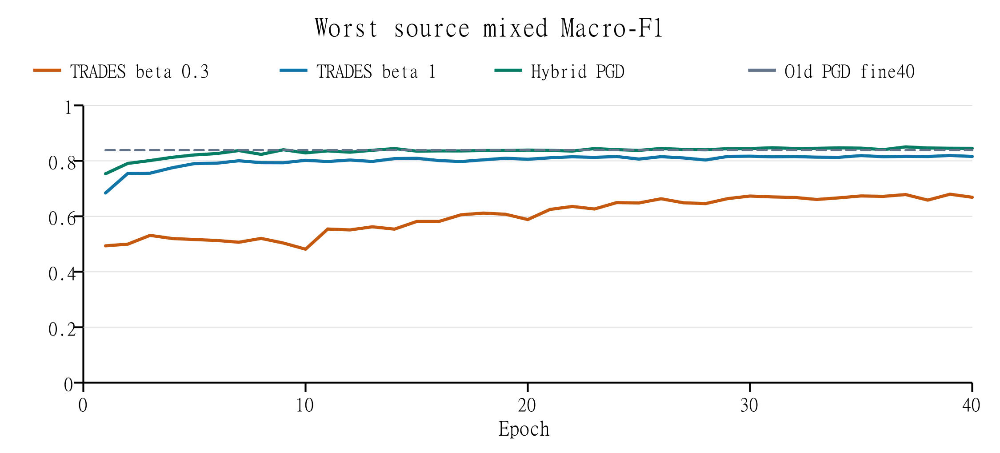

# Task 3 对抗样本防御

本任务针对测试阶段的图像逃逸攻击，目标是在干净图片与受扰动图片混合的测试集上预测真实类别。我们先分析课程提供模型的脆弱性，再比较对抗训练、源模型攻击训练、预测增强和模型集成。最终采用随机初始化残差网络与混合对抗训练模型的等权概率集成，并平均原图与水平翻转的预测。实际 Kaggle Public Macro-F1 从防御前的 0.51194 提高到 0.85725。

## 一 任务定义与数据

Dataset 3 包含 9,469 张有标签训练图片和 3,925 张无标签测试图片，均为 64×64 RGB，分属 10 个类别。训练图片是干净图片。项目说明指出，攻击者使用课程提供的分类器生成测试扰动，约一半测试图片受到攻击；每个像素的每个颜色通道相对原图最多改变 8/255，扰动由梯度方法生成，项目以 FGSM 为例，未公开测试攻击的完整配置[1]。真实标签仍对应图片中实际呈现的对象。

评估指标为 Macro-F1，即分别计算 10 个类别的 F1 后取算术平均。所有模型仅使用课程提供的数据；可使用的已有权重仅限 provided_model.pt，新增残差模型从随机初始化开始训练。输入只除以 255 转为 [0,1]，均值与标准差归一化在模型内部完成，以避免重复归一化。

为保持实验可比，使用固定随机种子 5577，按类别划分 7,575 张训练图片和 1,894 张验证图片。课程原模型已经见过全部原训练图片，残差学生的攻击教师也使用这一模型，最终 hybrid 又进行了全数据重训。因此，本地验证用于模型比较和安全诊断，泛化表现以实际测试反馈另行衡量。

## 二 攻击分析与初步验证

项目说明指出，攻击者使用课程原模型的梯度生成测试扰动，每个像素通道的变化不超过 8/255，并以 FGSM 为例[1]。据此，我们选择 FGSM 和 PGD 模拟这一类攻击：FGSM 代表单步梯度符号更新，PGD 代表在相同扰动预算内反复更新的多步攻击。初步验证围绕课程原模型这一攻击来源展开，检查这些扰动能否使原有分类器失效。

FGSM 沿增大真实标签交叉熵损失的方向更新一次像素，幅度为 8/255[2]。PGD 从预算范围内随机初始化扰动，每步沿梯度符号方向更新 2/255，再将图片投影回原图附近的 L∞ 球及 [0,1] 像素范围[3]。我们分别测试 PGD10，即 10 步、1 个随机起点，以及 PGD20×3，即 20 步、3 个随机起点。

首先比较两个分类器。第一个直接使用老师提供的原模型；第二个从同一份原模型权重开始，只使用 7,575 张干净训练图片微调 10 轮，作为继续训练的对照。微调采用批量 128、SGD 初始学习率 0.005、动量 0.9、权重衰减 0.0005 和余弦学习率衰减，保存验证表现最好的检查点用于比较。

评估使用另外划出的 1,894 张干净验证图片。我们先将原图分别送入两个分类器，得到干净条件的预测；再固定课程原模型的权重，用它对同一批验证图片生成 FGSM、PGD10 和 PGD20×3 攻击版本。随后将攻击图片分别送入原模型和干净微调模型，并与原来的真实标签比较，计算 Macro-F1。这里的攻击来源始终是课程原模型；对干净微调模型的评估反映这些攻击的迁移效果。表 1 列出全部验证图片受攻击时的浮点结果。

表 1 原模型来源攻击下的初步验证结果

| 分类器 | 干净 F1 | 源 FGSM F1 | 源 PGD10 F1 | 源 PGD20×3 F1 |
|---|---|---|---|---|
| 原课程模型 | 0.999476 | 0.191536 | 0.000000 | 0.000000 |
| 干净微调 10 轮 | 0.996238 | 0.189759 | 0.000000 | 0.000000 |

两个模型在干净图片上的 Macro-F1 都接近 1，但在原模型生成的 FGSM 下均降至约 0.19，在 PGD10 和 PGD20×3 下均降为 0。干净微调保持了原有的干净识别能力，却没有抵御这些源模型攻击；仅继续学习干净图片不足以解决当前问题。因此，后续防御将对抗样本加入训练，让模型同时学习正确识别干净图片和受到扰动的图片。

## 三 防御设计与选择依据

### 训练目标比较

在上述对照基础上，我们分别从课程原模型权重开始，使用干净图片和针对当前模型生成的 FGSM 或 PGD 图片进行对抗训练。初始比较均训练 10 轮，对抗组采用等权干净与对抗交叉熵；PGD 训练内层使用 7 步、单随机起点，并返回最后一次迭代。随后开展 40 轮增强 PGD 微调，加入随机裁剪和水平翻转，并将干净与对抗损失权重调整为 0.75 和 0.25，取得 Public 0.80418；另一个随机初始化 PGD 模型取得 0.79277。后续进一步比较两种 TRADES 设置与 hybrid 训练。

TRADES 使用 L = CEclean + β KL(pclean || padv)，其中 KL 的方向为干净预测到对抗预测，分别设置 β=0.3 和 β=1[4]。其内层使用 7 步 KL 攻击，干净参考分布停止梯度；外层保留两个预测分支的参数梯度。

Hybrid 使用 L = 0.75 CEclean + 0.25 CEadv。每个打乱的训练批次约一半图片接受当前模型生成的 PGD7，另一半接受冻结课程原模型生成的 PGD7。两种攻击均在训练增强后生成。训练共 40 轮，批量 128，SGD 初始学习率 0.01、动量 0.9、权重衰减 0.0005，采用余弦衰减以及随机裁剪和水平翻转。

候选首先须达到预先设定的干净 Macro-F1 门槛 0.857639，即此前微调参考值减去 0.005；再最大化课程源 FGSM 和 PGD20×3 两个 50% 混合指标中的较低值，最后以干净 F1 打破平局。表 2 展示保存的最佳检查点，括号中的总轮数表示学习率计划的完整长度。

表 2 训练目标的本地诊断比较

| 候选 | 选择轮数 | 干净 F1 | 较低源攻击混合 F1 | 通过干净门槛 |
|---|---|---|---|---|
| 早期增强 PGD 参考 | 39 / 40 | 0.862639 | 0.838496 | 是 |
| TRADES β=0.3 | 3 / 40 | 0.886343 | 0.531179 | 是 |
| TRADES β=1 | 39 / 40 | 0.835496 | 0.819390 | 否 |
| Hybrid | 37 / 40 | 0.874692 | 0.850292 | 是 |

TRADES β=0.3 的早期检查点虽保留干净性能，但迁移防御较弱；其最后一轮干净 F1 又降至 0.770978。β=1 没有得到通过干净门槛的检查点。

Hybrid 较低源攻击混合 F1 提高了 0.011796，因此被保留；其自身 PGD10 混合 F1 却由参考的 0.619333 降至 0.588201，显示出迁移与白盒效果间的取舍。本轮最终选择 Hybrid 继续实验。

图 1 展示三组训练完整 40 轮的较低源攻击混合 F1，即课程源 FGSM8 与 PGD20×3 混合指标中的较低值；虚线为早期增强 PGD 参考。两组 TRADES 的完整曲线也列入比较。

### 残差模型与最终集成

为引入架构多样性，我们实现宽度为 32 的 SmallResNet18[5]。网络采用 3×3、步长 1 的输入卷积，无初始最大池化；四个残差阶段的通道数为 32、64、128、256，每阶段含两个基本残差块，最后使用全局平均池化与 10 类线性分类头。网络不使用 dropout，也不加载外部权重。

残差模型在 7,575 张训练图片上训练 80 轮，批量 128，SGD 初始学习率 0.1，动量、权重衰减及余弦调度与前述设置一致。先由冻结课程模型缓存 FGSM8 和 PGD10 扰动，每张训练图片以相等概率选择一种攻击。干净图与对应对抗图使用相同的裁剪和翻转，并拼成一次联合前向，使批归一化同时观察两个域；损失为等权干净与对抗交叉熵。该方法侧重源攻击迁移，并不在每个训练批次中对残差学生执行自身 PGD。

残差模型保存的第 69 轮检查点单独未通过干净门槛。加入原图与翻转平均后，其干净 F1 为 0.854520、较低源攻击混合 F1 为 0.841923；与分割训练的 hybrid 第 37 轮按固定 50:50 集成后，两项分别为 0.880650 和 0.863015，通过筛选。

在最终部署前，hybrid 从课程权重重新开始，用全部 9,469 张有标签图片训练固定 37 轮，仍保留原 40 轮余弦计划，不再做验证或重新选择轮数。最终部署用这一冻结的全数据 hybrid 替换筛选时的分割训练 hybrid，保留第 69 轮残差模型。预测为两个模型、原图和水平翻转共四个概率分布的等权平均，最后取最大概率类别；这里平均的是概率，而不是原始 logits。

模糊、额外平移、多尺度平均和训练集批归一化重校准也进行了诊断。增加 80 或 96 像素视图降低了源攻击指标；hybrid 的批归一化重校准只带来约 0.0011 的较低源攻击混合 F1 增益，因此最终流程没有加入这些步骤。

## 四 Kaggle 成绩与安全性讨论

表 3 汇总五次实际提交的 Kaggle Public Macro-F1。

表 3 防御前后的 Kaggle Public 成绩

| 方案 | Public Macro-F1 | 相对原始基线增加 |
|---|---|---|
| 原课程模型 无防御 | 0.51194 | 0.00000 |
| 随机初始化 PGD 50 轮 | 0.79277 | 0.28083 |
| 增强 PGD 微调 40 轮 | 0.80418 | 0.29224 |
| 全数据 hybrid 37 轮与翻转平均 | 0.81816 | 0.30622 |
| 残差与 hybrid 等权集成及翻转平均 | 0.85725 | 0.34531 |

最终集成比此前最佳 0.80418 提高 0.05307，也比 hybrid 单独部署提高 0.03909。

完成防御设计后，我们进一步检查模型面对不同攻击来源时的表现。源模型攻击继续由冻结的课程原模型生成，并额外使用未参与本轮攻击样本训练的 random50 模型生成迁移攻击。自适应白盒攻击则直接针对待评估的防御模型生成扰动，梯度经过整个预测流程；对于最终集成，梯度同时经过两个模型、概率平均及翻转分支。

全量评估在同一批 1,894 张验证图片上使用 FGSM、PGD10 和 PGD20×3，预算均为 8/255，PGD 步长为 2/255。评估用 PGD 跨迭代和随机起点保留已找到的误分类候选，浮点输入与 8 位量化输入分别预测。表 4 汇总 PGD20×3：混合列固定使用 947 张攻击图片和 947 张干净图片的预测，重新计算 Macro-F1；最后一列使用全部图片受到白盒攻击时的预测。两份部署方案均含全数据重训的 hybrid，这些本地结果用于样本内安全诊断。

表 4 冻结部署方案的本地安全检查 统一使用 PGD20×3

| 方案 | 课程源混合 F1 | random50 源混合 F1 | 白盒混合 F1 | 白盒全攻击 F1 |
|---|---|---|---|---|
| Hybrid 与翻转平均 | 0.986037 | 0.888931 | 0.687515 | 0.377272 |
| 最终等权集成与翻转平均 | 0.923071 | 0.807639 | 0.496969 | 0.052530 |

最终集成在 Public 上领先，但在这组自适应白盒检查中显著弱于 hybrid。这表明我们获得的是针对课程源攻击场景的实用改进，而非广泛白盒鲁棒性。换用 random50 源后迁移效果也下降，说明攻击来源变化值得单独评估，不能只依赖课程原模型生成的攻击。

进一步从验证集按每类 20 张、种子 5577 固定抽取 200 张图片，分别进行 50 步、5 个随机起点的 CE 和 margin 目标白盒压力测试。最终集成在 CE-PGD50×5 和 margin-PGD50×5 下的 Macro-F1 分别为 0.049514 和 0.054438；同时在干净图及两类攻击下均正确的联合存活率为 3.5%，hybrid 对照为 34.0%。全量 PGD10 到 PGD20×3，以及相同 200 张上的 CE-PGD20×3 到 CE-PGD50×5，均保留了较短搜索已找到的失败；所有浮点和 8 位量化扰动通过 8/255 边界检查。

### 不同攻击算法的补充评估

为检验 FGSM 和 PGD 之外的攻击，补充实现了 Carlini–Wagner（C&W）优化攻击[7,8]。我们使用非定向 C&W-L2，最小化平方 L2 距离与真实类别相对最强错误类别的 margin 惩罚之和，以 c 平衡两项；通过 tanh 重参数化保证像素范围，使用 Adam 优化输入变量，并逐张搜索 c。攻击过程中模型保持冻结，梯度经过完整集成与翻转流程。

设置为置信参数 κ=0、初始 c=0.001、学习率 0.01、7 轮常数搜索，每轮最多 500 步，并使用批次总损失停滞提前退出；批量为 64。标准 C&W-L2 只约束像素在 [0,1]，可能超过项目的逐通道 8/255 限制。因此另设一个在原图 ±8/255 与 [0,1] 交集中优化的受限变体。后者是额外施加 L∞ 盒约束的 C&W-L2 变体。每张图片跨迭代和常数保留找到的最小 L2 成功候选，未成功时保留干净输入。

三个模型均使用此前固定的 200 张图片，每类 20 张；按类别和种子 5577 固定采样。表 5 的所有 F1 均为这 200 张图片全部受攻击的浮点结果，PGD20×3 在同一采样上重新运行。ASR 为最初预测正确的图片中被攻击改为错误的比例，原本已错的图片不计为新增攻击成功。表 5 用于同采样比较，表 4 则使用全 1,894 张图片。

表 5 相同 200 张图片上的 C&W 与 PGD 对照

| 方案 | PGD20×3 F1 | CW-L2 F1 | 受限 CW-L2 F1 | 受限 CW ASR |
|---|---|---|---|---|
| 原课程模型 | 0.000000 | 0.000000 | 0.000000 | 100.00% |
| Hybrid 与翻转平均 | 0.387896 | 0.000000 | 0.392553 | 62.12% |
| 最终等权集成与翻转平均 | 0.071876 | 0.000000 | 0.142899 | 85.79% |

标准 C&W-L2 在三个模型上均使本次浮点 Macro-F1 降为 0，但分别有 20、195、124 个输出超过项目的 L∞ 预算，因此这一列反映放宽扰动范围后的攻击效果。成功改变最初正确预测的样本中，搜索所得 L2 距离中位数分别为 0.3122、1.6953、0.7230。

在受限变体下，原课程模型的攻击成功率为 100.00%，最终集成为 85.79%，其 Macro-F1 为 0.142899。相对于原模型，防御有所改善，但大部分原本正确的图片仍被攻击成功。Hybrid 的受限 C&W F1 为 0.392553，再次显示 Public 最优方案与本地强攻击下最优方案并不一致。

两种算法找到的失败样本也不同：受限 C&W 在 Hybrid 和最终集成上分别新增找到 5 张和 0 张 PGD20×3 未找到的失败。将干净预测、同采样 PGD20×3 和受限 C&W 一起检查，联合正确率分别为 35.0% 和 6.5%。C&W 对 Hybrid 补充发现了 PGD 未覆盖的失败；对最终集成，本轮 PGD 找到的失败更多。

把最小距离浮点候选直接四舍五入为 8 位后，受限 C&W 的 F1 在原模型、Hybrid、最终集成上分别为 1.000000、0.605241、0.741563。最小距离候选位于决策边界附近，量化和计算后端的数值差异会改变部分预测。本轮仅做事后量化，离散像素上的稳定攻击还需要单独搜索；已在相同 GPU 设置下复现全部保存预测。

## 五 性能评估与资源开销

实验设备为 NVIDIA GeForce RTX 5070 Ti 16 GB、Intel Core Ultra 9 285K 和 64 GB 系统内存，软件为 Python 3.12.13、PyTorch 2.9.1+cu128、NumPy 2.2.6 和 Pillow 11.3.0。表 6 列出逐轮计时之和，以及训练和对应验证期间的 PyTorch 活跃张量显存峰值；MiB 为 2²⁰ 字节。

表 6 本轮主要训练的耗时与显存

| 训练运行 | 完成轮数 | 记录轮耗时合计 秒 | 峰值 allocated MiB |
|---|---|---|---|
| TRADES β=0.3 | 40 | 513.623 | 1306.37 |
| TRADES β=1 | 40 | 523.022 | 1300.20 |
| Hybrid 分割训练 | 40 | 511.945 | 1306.39 |
| 残差源攻击训练 | 80 | 1441.541 | 2560.92 |
| Hybrid 全数据固定重训 | 37 | 470.767 | 1301.49 |

三组 40 轮运行的计时包括训练、自身 PGD10 验证及缓存源攻击条件的验证推理；残差运行只包含干净与源攻击验证，不含逐轮学生白盒攻击；全数据 hybrid 不进行验证。计时排除模型初始化、初始图片解码、初始攻击缓存生成或加载以及检查点写盘。表中五组逐轮计时累计约 57.68 分钟，仅描述这些已记录区间。

表 7 比较两份部署方案在全部 3,925 张测试图片上的单次推理，批量大小为 64。每份方案都重复完整推理两次，预测标签相同，logits 逐位一致。

表 7 测试集推理耗时与显存

| 部署方案 | 第一次 秒 | 第二次 秒 | 第一次吞吐 张每秒 | 峰值 allocated MiB |
|---|---|---|---|---|
| Hybrid 与翻转平均 | 0.322 | 0.349 | 12190.77 | 174.54 |
| 最终等权集成与翻转平均 | 1.049 | 1.031 | 3740.66 | 252.22 |

推理计时排除预热，包含数据加载器迭代、除以 255、主机与设备间复制、模型前向和输出回传；不包含最初的 PNG 解码、模型载入、指标计算与 CSV 写盘。最终方案的 allocator 保留显存峰值为 332 MiB，活跃张量峰值为 252.22 MiB，两者都不等于显卡进程总占用。两个紧凑检查点合计约 15.25 MiB。CPU 进程内存峰值未测量。

最终集成在推理时需要两个模型与两种视图，计算量高于单模型方案；但在本机已测条件下，完整测试集的计时区间仍约为一秒。攻击生成的开销则明显更大。六组冻结后安全评估命令累计耗时约 290.31 秒，其中包含攻击搜索和相关评估操作，不属于正常预测耗时。

新增三模型、两种 C&W 范围的六组优化与推理计时区间累计 904.77 秒，受限运行中最高 allocated 显存为 3582.28 MiB。其计时包含输入复制、扰动搜索及浮点和 8 位预测，排除最初模型与图片加载、指标计算和文件写入。

## 六 主要发现与未来工作

实验得到三个直接结论。第一，干净验证性能很高的课程模型仍可能在小幅梯度扰动下失效，需要单独评估攻击条件。第二，结合源模型攻击训练与不同架构的方案提高了本项目 Public 评测子集的 Macro-F1，最终 Public Macro-F1 达到 0.85725；但残差单模型未通过干净门槛，集成是最终选择的重要组成部分。第三，PGD 与 C&W 均暴露了最终集成的白盒脆弱性，其中受限 C&W 使 85.79% 的原本正确样本误分类，显示出源攻击迁移防御与自适应白盒防御之间的差距。

后续工作应优先建立更独立的评估：从随机初始化训练仅见训练分割的攻击教师与目标模型，并在独立保留数据上重复不同种子，降低教师暴露和反复选择带来的偏差。训练方面可进一步加入学生自身的多起点 PGD、不同攻击源和 margin 目标，在预先固定的选择规则下研究干净损失与对抗损失的权重。部署方面则可比较取消翻转、减少模型或蒸馏集成后的性能与吞吐变化，并继续单独检查量化输入与不同攻击来源。

配置、固定划分、算法实现与实验记录已归档于项目代码仓库[6]。

## 参考文献与实验记录

[1] COMP5577 Project 项目说明，Dataset 3 及第 6 至 10 节。

[2] Goodfellow I J, Shlens J, Szegedy C. Explaining and Harnessing Adversarial Examples. 2015. https://arxiv.org/abs/1412.6572

[3] Madry A, Makelov A, Schmidt L, Tsipras D, Vladu A. Towards Deep Learning Models Resistant to Adversarial Attacks. ICLR 2018. https://arxiv.org/abs/1706.06083

[4] Zhang H, Yu Y, Jiao J, et al. Theoretically Principled Trade-off between Robustness and Accuracy. ICML 2019. https://arxiv.org/abs/1901.08573

[5] He K, Zhang X, Ren S, Sun J. Deep Residual Learning for Image Recognition. 2015. https://arxiv.org/abs/1512.03385

[6] 项目代码与实验档案。https://github.com/Cobblepot2/COMP-5577-Dataset3

[7] Carlini N, Wagner D. Towards Evaluating the Robustness of Neural Networks. IEEE Symposium on Security and Privacy 2017. https://arxiv.org/abs/1608.04644

[8] COMP5577 AI Security Week 5 Evasion Attack，课程讲义，第 24 至 27 页。
